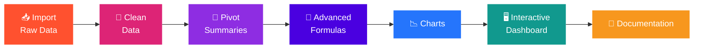

# SALES-DATASET-DASHBOARD
<!-- ===================== HEADER BANNER (animated) ===================== -->
<div align="center">


<!-- Live typing animation -->
<a href="https://git.io/typing-svg">
  
</a>

<br/>

<!-- Colourful badges (START) -->


<br/>


</div>

<br/>

<!-- ===================== THOUGHT (START) ===================== -->
<div align="center">

> 💭 **Thought of the Day**
>
> ### *"Without data, you're just another person with an opinion."*
> — W. Edwards Deming

</div>

<br/>

---

<!-- ===================== OVERVIEW ===================== -->


This workbook is my **Final Practical Exam** project. It takes a small raw sales dataset (20 records, Jan–May 2022) and walks through the full analysis cycle:

**import → clean → summarize → apply formulas → visualize → build an interactive dashboard → document everything.**

Everything is **formula-driven**, so when the data changes, the summaries, charts and dashboard update automatically. ⚡

---


<!-- ===================== KEY METRICS ===================== -->


<div align="center">

| 💰 Total Sales | 📈 Total Profit | 🎯 Profit Margin | 🧾 Orders |
|:---:|:---:|:---:|:---:|
| **12,038** | **4,025** | **33.4%** | **20** |

</div>

| 🏆 Insight | Result |
|---|---|
| Top region by sales | **East** (3,467) |
| Top product by sales | **Product E** (3,222) |
| Biggest profit share | **Product E** (~30%) |
| Best month for sales | **January** (2,880) |

---

<!-- ===================== WORKFLOW ===================== -->




---

<!-- ===================== CHARTS GALLERY ===================== -->


<div align="center">


<sub>🖼️ Dashboard + all 4 charts in one view</sub>

</div>

| 📊 Chart | 💡 Insight |
|---|---|
| Column · Sales by Region | 🏆 **East** is the top region with 3,467 sales |
| Pie · Profit Share | 💎 **Product E** gives the biggest profit share (30%) |
| Line · Monthly Trend | 🔥 **January** is the best month for sales (2,880) |
| Bar · Sales vs Profit | 🚀 **Product E** is the top product by sales (3,222) |

> 💡 In the workbook, the insight line under each chart is **formula-driven**, so it changes automatically when the data changes.

---

<!-- ===================== SHEETS ===================== -->


| # | Sheet | Task | What it contains |
|:-:|---|:-:|---|
| 1 | 📘 **Documentation** | 7 | Overview, sheet guide, naming conventions, how-to-use steps |
| 2 | 📥 **Raw_Data** | 1 | Original imported dataset, kept exactly as received |
| 3 | 🧹 **Clean_Data** | 2 & 4 | Cleaned data + VLOOKUP / INDEX-MATCH / IF / Nested IF columns |
| 4 | 🔎 **Lookups** | 4 | Product Targets and Region Managers reference tables |
| 5 | 🧮 **Pivot_Summary** | 3 | Region, Product, Month summaries and Region × Product matrix (SUMIFS) |
| 6 | 📉 **Charts** | 5 | Column, Pie, Line and Bar charts with auto insight lines |
| 7 | 🖥️ **Dashboard** | 6 | Interactive dashboard with dropdown filters, KPI cards and 4 charts |

---

<!-- ===================== TASKS ===================== -->


- ✅ **Task 1 – Dataset Import:** CSV text split into 7 proper columns (SalesID, Product, Region, Sales, Profit, Year, Date); Date converted to real dates.
- ✅ **Task 2 – Data Cleaning:**
  - No duplicate SalesIDs (1–20 are unique).
  - Blank Sales (SalesID 4 and 10) filled with the **product average** using a formula.
  - Mismatched years fixed with `YEAR(Date)` and highlighted in yellow.
- ✅ **Task 3 – Pivot Summaries:** Region, Product, Month and Region × Product tables built with `SUMIFS` and named ranges.
- ✅ **Task 4 – Advanced Formulas:** VLOOKUP, INDEX-MATCH, IF and Nested IF.
- ✅ **Task 5 – Data Visualization:** 4 charts with titles, data labels, insight lines and conditional formatting.
- ✅ **Task 6 – Interactive Dashboard:** Region / Product dropdowns and From–To month timeline.
- ✅ **Task 7 – Documentation:** Documentation sheet with cleaning log, formulas, naming rules and usage steps.

---

<!-- ===================== FORMULAS ===================== -->


| Function | Used for | Example |
|---|---|---|
| **VLOOKUP** | Product target sales | `=VLOOKUP(B2,Lookups!$A$3:$B$7,2,FALSE)` |
| **INDEX + MATCH** | Region manager | `=INDEX(Lookups!$E$3:$E$7,MATCH(C2,Lookups!$D$3:$D$7,0))` |
| **IF** | Sales level (High / Low) and Met Target? | `=IF(K2>=600,"High","Low")` |
| **Nested IF** | Performance label | `=IF(D2="","Missing (Filled)",IF(K2>=800,"Excellent",IF(K2>=500,"Good","Poor")))` |
| **SUMIFS / COUNTIFS** | Summaries and dashboard KPIs | `=SUMIFS(d_Sales,d_Region,A4)` |
| **AVERAGEIFS** | Fill blank Sales | `=AVERAGEIFS($D$2:$D$21,$B$2:$B$21,B2)` |
| **IFERROR, TEXT, YEAR, MONTH** | Safe division, month names, date parts | `=IFERROR(E2/K2,0)` |

> 🎯 **Performance rules:** Excellent ≥ 800 · Good ≥ 500 · Poor < 500 · Sales Level: High ≥ 600.

---

<!-- ===================== DASHBOARD ===================== -->


> 👆 See the full dashboard preview in the **Dashboard & Charts Gallery** above.

The **Dashboard** sheet responds live to your filters:

1. Open the **Dashboard** sheet.
2. Change the yellow dropdown cells: **Region** and **Product** (`All` = no filter).
3. Change **From Month** and **To Month** (`1 = Jan … 5 = May`), which works as the timeline filter.
4. Watch the **4 KPI cards**, the **insight strip** and **all 4 charts** update automatically. ⚡

**Dynamic named ranges:** `d_Product`, `d_Region`, `d_Sales`, `d_Profit`, `d_Month` (see *Formulas → Name Manager*).

---

<!-- ===================== CONDITIONAL FORMATTING ===================== -->


- 🌈 **Color scale** on Sales (Clean)
- 📊 **Data bars** on Profit
- 🔴 **Red highlight** when Sales < 500
- ⬆️⬇️ **Arrow icons** on Profit Margin
- 🟡 **Yellow fill** where the original Year was wrong
- 🟢🔴 **Yes / No colours** on *Met Target?*

---

<!-- ===================== COLOUR CODE ===================== -->


- **Sheets:** Capitalised words joined with an underscore.
- **Named ranges:** start with `d_`.
- **Colours:** 🔵 blue text = input / raw values · ⚫ black = formulas · 🟡 yellow fill = cells you can change.
- ⚠️ **Note:** Product targets and manager names in *Lookups* are **assumed sample values** (not part of the original data). Edit the blue cells as needed.

---

<!-- ===================== HOW TO OPEN ===================== -->


```text
1. Download / open the workbook in Microsoft Excel or upload it to Google Sheets.
2. Read the Documentation sheet first.
3. Explore Clean_Data → Pivot_Summary → Charts.
4. Go to Dashboard and play with the yellow filter cells.
```

---

<!-- ===================== AUTHOR ===================== -->


<div align="center">

### ✨ **Kavita Khushalani** ✨

*Data Analyst in the making · Excel · SQL · Dashboards*

</div>

---

<!-- ===================== THOUGHT (END) ===================== -->
<div align="center">

> 💭 **Thought to Remember**
>
> ### *"Data is the new oil, but analysis is the engine that makes it move."*

<br/>

<!-- Colourful badges (END) -->


<br/>

<a href="https://git.io/typing-svg">
  
</a>

</div>

<!-- ===================== FOOTER BANNER (animated) ===================== -->

